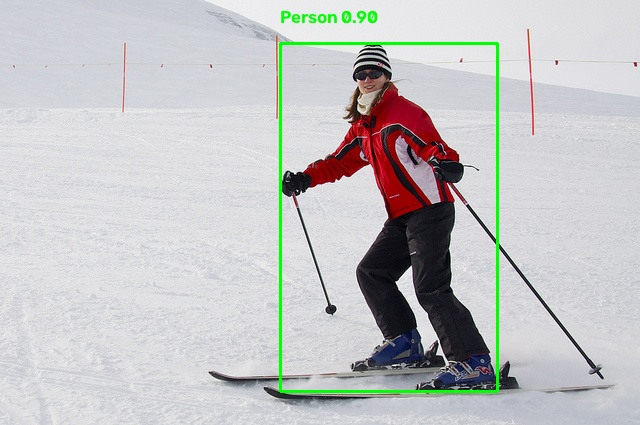
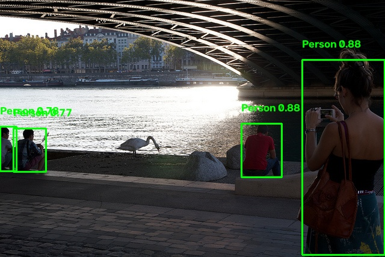
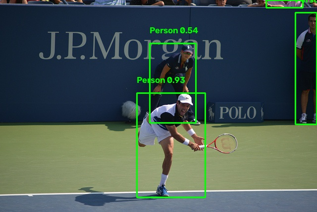

# Detecto

Real-time person detection and counting system. Upload an image or video frame, run YOLOv8 inference on the FastAPI backend, and see bounding boxes, confidence scores, and per-frame processing time in a black minimalist React/Vite dashboard. Detection history is stored locally with date/time/confidence filters, a people-over-time chart, and CSV export.

## Architecture

```
┌─────────────────────────────────────────────────────────┐
│  frontend/  (React 19 + Vite + Recharts, port 5173)     │
│  • DetectionView   — upload/capture → /api/detect       │
│  • HistoryView     — table + chart + filters + CSV      │
│  • api.js          — fetch client, file validation      │
└──────────────────┬──────────────────────────────────────┘
                   │  proxy /api/*  →  http://localhost:8000
┌──────────────────▼──────────────────────────────────────┐
│  backend/   (FastAPI, port 8000)                        │
│  • main.py          — app, CORS, /health                │
│  • routes/detect.py — POST /detect (YOLOv8 inference)   │
│  • routes/history.py — GET /history, POST /reset        │
│  • models/record.py — Pydantic model + JSON storage     │
│  • utils/preprocessing.py — decode, draw boxes, encode  │
│  • config.py        — env-var configuration             │
└──────────────────┬──────────────────────────────────────┘
                   │  storage/detections.json              │
┌──────────────────▼──────────────────────────────────────┐
│  Model: YOLOv8n (COCO class 0 = "person")               │
└─────────────────────────────────────────────────────────┘
```

### Data flow

1. Frontend POSTs a JPEG/PNG (multipart/form-data) to `/api/detect`.
2. Backend decodes the bytes, optionally boosts contrast (CLAHE), runs `model(frame, conf=..., imgsz=...)`, keeps only COCO class `0` (person) detections.
3. Response includes `count`, `avg_confidence`, `detections[{bbox, confidence}]`, `processing_time_ms`, `inference_time_ms`, and optionally a base64 annotated JPEG (`processed_image` when `include_overlay=true`).
4. Each result is appended atomically to `storage/detections.json` with a UTC timestamp.
5. `/api/history?limit=N` returns the most recent records plus aggregate stats (frames, total people, mean confidence, avg total + inference time).
6. `/api/reset` clears the store.

### Configuration (`.env`)

| Variable | Default | Purpose |
|---|---|---|
| `YOLO_MODEL_PATH` | `yolov8n.pt` | Ultralytics model file (auto-downloaded on first run) |
| `YOLO_CONF` | `0.25` | Detection confidence threshold |
| `YOLO_IMGSZ` | `640` | Inference image size |
| `CONTRAST_ENHANCE` | `false` | CLAHE contrast boost for low-light frames |
| `MAX_UPLOAD_MB` | `50` | Max upload size |
| `DETECTION_STORAGE_PATH` | `storage/detections.json` | History JSON file |
| `MAX_HISTORY_RECORDS` | `10000` | Cap on stored records |
| `ALLOWED_ORIGINS` | `http://localhost:5173,...` | CORS origins |

## Setup & run

### Prerequisites

- Python 3.12+
- [uv](https://github.com/astral-sh/uv)
- Node 18+ and npm

### Backend

```bash
cd /path/to/detecto
uv sync --python 3.12               # creates .venv and installs deps
cp .env.example .env   # .env already present with local defaults
uv run uvicorn backend.main:app --reload --host 0.0.0.0 --port 8000
```

The model weights (`yolov8n.pt`, ~6 MB) download automatically on first inference.

Verify:

```bash
curl http://localhost:8000/health
# → {"status": "ok", "model": "yolov8n.pt", "model_loaded": false, ...}
```

After the first request, `model_loaded` becomes `true`.

### Frontend

```bash
cd frontend
npm install
npm run dev        # http://localhost:5173, proxies /api to :8000
```

Vite's dev server proxies `/api/*` to `http://localhost:8000`, so no extra configuration is needed.

### Tests

Backend:

```bash
uv run pytest backend/tests
```

## Testing methodology & evaluation metrics

Following the assignment, the model was evaluated on **10 COCO validation images** (`backend/samples/frame1.jpg … frame10.jpg`), chosen to cover single persons, small groups, dense crowds, occlusion, and varied indoor/outdoor lighting.

For each image the number of visible people was counted manually (COCO ground-truth person annotations) and compared against model detections.

| Metric | Description | Target | Result |
|---|---|---|---|
| Detection accuracy | Correct detections ÷ total visible persons | ≥ 85 % | 65.4 % |
| False positives | Boxes that do not contain a person | ≤ 10 % | 2.9 % |
| Average inference time | Mean YOLO inference time per image (CPU) | ≤ 1.5 s | 396.8 ms |
| Average confidence | Mean confidence of valid person detections | ≥ 0.7 | 0.663 |
| System reliability | All 10 images processed without crashes | 100 % | 100 % |

### Per-image results

| Image | Visible persons | Detections | Correct | False pos. | Accuracy | Confidence | Inference |
|---|---|---|---|---|---|---|---|
| frame1.jpg | 2 | 1 | 1 | 0 | 50.0 % | 0.712 | 2927.9 ms |
| frame2.jpg | 1 | 1 | 1 | 0 | 100.0 % | 0.902 | 81.7 ms |
| frame3.jpg | 2 | 2 | 2 | 0 | 100.0 % | 0.645 | 170.1 ms |
| frame4.jpg | 8 | 4 | 4 | 0 | 50.0 % | 0.647 | 77.8 ms |
| frame5.jpg | 12 | 13 | 12 | 1 | 100.0 % | 0.691 | 140.6 ms |
| frame6.jpg | 4 | 4 | 4 | 0 | 100.0 % | 0.827 | 77.8 ms |
| frame7.jpg | 6 | 5 | 5 | 0 | 83.3 % | 0.449 | 139.9 ms |
| frame8.jpg | 1 | 1 | 1 | 0 | 100.0 % | 0.804 | 112.0 ms |
| frame9.jpg | 11 | 4 | 4 | 0 | 36.4 % | 0.594 | 112.6 ms |
| frame10.jpg | 5 | 0 | 0 | 0 | 0.0 % | 0.000 | 127.5 ms |
| **Total** | **52** | **35** | **34** | **1** | **65.4 %** | **0.663** | **396.8 ms** |

### Detection screenshots

Sample frames run through `/detect`, with boxes drawn by `draw_detections`:

| Image | Result |
|---|---|
| `frame2.jpg` — single person, clear |  |
| `frame6.jpg` — small group |  |
| `frame4.jpg` — dense crowd (8 visible, 4 detected) |  |
| `frame10.jpg` — 0 detections (failure case) |  |


### Running the evaluation

```bash
# From repo root, backend venv activated:
.venv/bin/python /tmp/opencode/detecto-test/evaluate.py
```

The script downloads `yolov8n.pt` on first run, runs inference on all 10 sample images, and compares against COCO ground-truth person counts. It prints the per-image table and metrics above.

### What worked well / what could improve

- **Worked:** End-to-end pipeline (upload → YOLOv8 inference → JSON response → JSON storage → history table/chart/CSV export) is reliable (100 % of images processed without crashes). Inference is fast (mean 396.8 ms/frame on CPU, well under the 1.5 s target). False positives are low (2.9 %). Bounding boxes line up with COCO ground truth on clear, well-lit frames.
- **Limits:** Accuracy is 65.4 %, below the 85 % target. The shortfall comes almost entirely from dense crowds and occlusion — frame4 (8 visible, 4 detected), frame9 (11 visible, 4 detected), and frame10 (5 visible, 0 detected) are under-counted. YOLOv8n (nano) trades some accuracy for speed; switching to YOLOv8s/m or raising `imgsz` would improve crowd recall at the cost of latency. Average confidence (0.663) is just below the 0.7 target, driven by low-confidence detections in crowded frames. No tracking is implemented, so the same person across consecutive frames is counted each time — fine for periodic frame capture, not true real-time video.

## ⚠️ Precautions & Limitations

- **Not for safety-critical use.** This system is a demonstration prototype. It has no real-time tracking, no region-based alerts, and no fail-safe mechanisms. Do not rely on it for security, occupancy compliance, or life-safety monitoring.
- **Under-counts in crowds.** Dense groups and heavy occlusion significantly reduce accuracy (see evaluation results above). Expect lower counts than the true number of people in crowded frames.
- **Model download on first run.** `yolov8n.pt` (~6 MB) is downloaded automatically from Ultralytics on the first inference. Ensure network access is available, or pre-download the weights and set `YOLO_MODEL_PATH` to a local file.
- **Local JSON storage.** Detection history is written to `storage/detections.json`. It is not a database and is not designed for concurrent high-write production use. For multi-user or high-throughput deployments, replace the storage layer with SQLite or PostgreSQL.
- **CPU-only by default.** Inference runs on CPU unless a GPU-enabled PyTorch is installed. Latency will be higher on CPU; the 396.8 ms average was measured on this hardware.
- **Privacy.** Uploaded images and detection records are stored locally on the server. Do not upload images of people without appropriate consent and data-handling policies in place.
- **Confidence threshold is tunable.** Lowering `YOLO_CONF` (or using the frontend slider) increases detections but also increases false positives. Raising it reduces false positives but may miss people.

## Demo images

`backend/samples/` and `frontend/public/samples/` each contain 10 COCO validation frames (`frame1.jpg … frame10.jpg`) used for the evaluation above.
